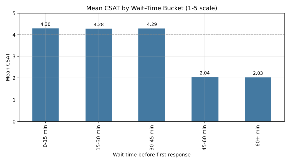

# Customer Support Operations Analysis

What actually drives customer satisfaction (CSAT) in a support operation —
and where is the backlog? An analysis of **2,500 support tickets** using
Python, pandas, and seaborn.

## The question

Support teams usually assume faster *resolution* is what customers care
about. This analysis tests that against the data: is CSAT driven by how
long a ticket waits for a first response, how long it takes to resolve,
or by the ticket's category, channel, or priority?

## The data

`data/customer_support_dataset.csv` — 2,500 tickets, 8 columns:

| Column | Description |
|---|---|
| Ticket_ID | Unique ticket identifier |
| Category | Technical Issue, Billing, Account Access, Product Inquiry |
| Channel | Email, Phone, Live Chat, Social Media |
| Priority | Low, Medium, High, Urgent |
| Status | Closed, Open, Pending |
| Wait_Time_Mins | Minutes before first response |
| CSAT_Score | Customer satisfaction, 1–5 |
| Resolution_Time_Hours | Hours to close (Closed tickets only) |

Note: `Resolution_Time_Hours` is blank for the 463 Open/Pending tickets —
a ticket that isn't closed has no resolution time yet. All analysis of
resolution time uses the 2,037 Closed tickets only.

## How to run

```bash
pip install -r requirements.txt
python analysis.py
```

This prints the full findings to the terminal and saves 5 charts to `images/`.

## Findings

### 1. Wait time is the whole story — and 45 minutes is a cliff

| Wait time | Tickets | Mean CSAT | % with CSAT ≤ 2 |
|---|---|---|---|
| 0–15 min | 1,129 | 4.30 | 0.0% |
| 15–30 min | 592 | 4.28 | 0.0% |
| 30–45 min | 333 | 4.29 | 0.0% |
| 45–60 min | 211 | 2.04 | 61.1% |
| 60+ min | 233 | 2.03 | 67.8% |

- **444 tickets (17.8%) waited more than 45 minutes.** Their mean CSAT was
  **2.03**, versus **4.29** for tickets answered within 45 minutes — a gap
  of **2.26 points** on a 5-point scale.
- Correlation between wait time and CSAT is **−0.588**.
- **Every single low-CSAT ticket (CSAT ≤ 2) waited more than 45 minutes.**
  Not one ticket answered within 45 minutes scored 2 or below. Of the
  tickets that waited >45 min, **64.6%** scored CSAT ≤ 2.
- The effect is a cliff, not a slope: CSAT is flat (~4.3) up to 45 minutes
  and collapses past it. Mean wait overall is 25.6 min (median 17.4 min).



### 2. Resolution speed does not move CSAT

- Mean resolution time (Closed tickets): **11.8 hours** (median 8.3 hours).
- Correlation between resolution time and CSAT: **−0.03** — effectively zero.
- Customers don't punish slow closes; they punish slow *first responses*.
  Staffing the first-response queue beats chasing faster closes.

### 3. Category, channel, and priority barely matter

- Mean CSAT by category: 3.76–3.92. By channel: 3.85–3.92. By priority:
  3.87–3.94. All nearly flat.
- Mean wait time is also flat across category (24.2–27.6 min), channel
  (25.5–25.9 min), and priority (24.3–26.1 min) — waiting too long is not
  a category problem, it's a queue problem.
- Ticket mix: Technical Issue 1,002 (40.1%), Billing 760 (30.4%),
  Account Access 493 (19.7%), Product Inquiry 245 (9.8%). Channels:
  Email 893 (35.7%), Phone 875 (35.0%), Live Chat 498 (19.9%),
  Social Media 234 (9.4%).

### 4. The backlog: 463 tickets (18.5%)

- Open 365 (14.6%), Pending 98 (3.9%).
- By priority: Low 243, Medium 127, High 73, **Urgent 20**.
- By category: Technical Issue 186, Billing 152, Account Access 80,
  Product Inquiry 45.
- Urgent tickets are the slowest to resolve (mean 14.3 hours vs 10.7–12.2
  for other priorities) — the opposite of what the priority label promises.

## What this means for a support team

1. **Set a 45-minute first-response SLA and staff to it.** Everything
   under 45 minutes scores ~4.3; everything over it scores ~2.0. That
   threshold is worth more than any other improvement in this data.
2. **Triage the 20 Urgent + 73 High tickets sitting in the backlog first.**
3. **Stop optimizing resolution time for CSAT** — it doesn't move the
   number. Put the effort into first response instead.

## Files

```
customer-support-analysis/
├── analysis.py        # full analysis: tables, charts, findings
├── requirements.txt   # pandas, matplotlib, seaborn
├── README.md
├── data/
│   └── customer_support_dataset.csv   # 2,500 tickets
└── images/
    ├── tickets_by_category.svg
    ├── tickets_by_channel.svg
    ├── wait_vs_csat.svg
    ├── resolution_by_priority.svg
    └── status_by_priority.svg
```
